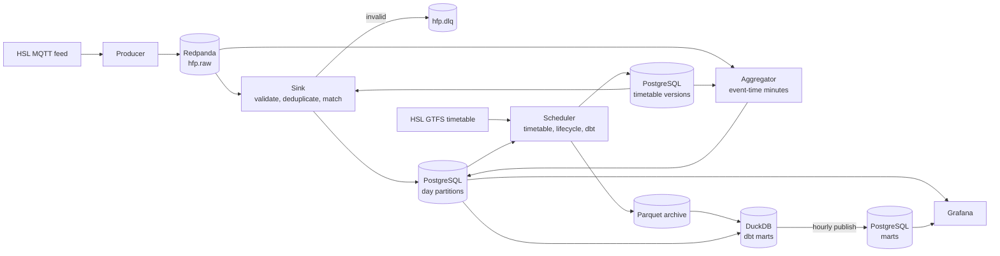

# Realtime Transit Platform

A streaming data platform that ingests live vehicle positions from Helsinki's public transport network, processes them in real time, and compares what actually happens on the streets with the published timetable.


## Background

My earlier project, an academic data platform, was built around batch processing: data moves once a day, and a few hours of delay do not matter. Many real systems cannot wait that long. A public transport operator wants to know *now* that a line is running late, that two buses are travelling bumper to bumper, or that a vehicle has stopped reporting.

I wanted to learn how data engineering works when data never stops arriving, so I built this project in my free time. I chose Helsinki because its transport authority, HSL, publishes the position of every bus, tram, metro and train as an open real-time feed, together with the full timetable. It is real data, at real volume, with all the problems real data has: duplicates, late messages, gaps, vehicles that go silent and vehicles that report the wrong journey.

## The problem

Every vehicle in the network reports its position about once per second. On a weekday morning that is about 1,600 messages per second from some 1,400 vehicles. Each message on its own says little. The questions people actually ask need the stream to be cleaned, joined with the timetable and aggregated over time:

- Which lines are running late right now, and by how much?
- Which stops have the worst punctuality, and at what time of day?
- Where do vehicles bunch together instead of keeping their scheduled interval?
- Which vehicles have stopped sending data?

The data arrives continuously, out of order and sometimes twice. The platform has to process it with low latency, never lose or double-count a message, and still keep a reliable history for analysis.

## What the project builds

**1. Timetable loader (batch).** Downloads HSL's timetable in GTFS format and loads it into PostgreSQL as a new version, in one transaction that switches the current version only when every file has loaded and validated. Every event is matched against the version that was valid on its day, and scheduled times past midnight and on daylight saving days are converted to UTC as the GTFS reference defines them. The full timetable, 8.8 million scheduled stop times, loads in 118 seconds.

**2. Stream producer.** Subscribes to HSL's MQTT feed and publishes every message to a Kafka-compatible stream (Redpanda), keyed by vehicle so that each vehicle's events stay in order. It can record the feed to files and replay a recording at any speed, so development, tests and benchmarks never depend on the live feed, and a replay always produces exactly the same topic contents.

**3. Stream processor.** Validates every message against a schema, removes duplicates, matches each event to its scheduled trip and writes it to day-partitioned PostgreSQL tables. Invalid messages go to a dead-letter topic. Writes are idempotent and offsets are committed only after the data is stored, so a crash never loses or duplicates an event. Arrivals and departures carry a delay measured by the platform against the timetable, next to the operator's own live estimate.

**4. Real-time aggregation.** A second consumer of the same stream computes per-minute statistics by event time: delay per line and per stop, active vehicles, and which vehicles have gone silent or report a journey that should have ended long ago. A minute is published ten seconds after it ends and corrected by later messages for ten more minutes. Delays are counted once per journey, so the coupled units of a train do not vote two or three times. The streamed results equal a batch recomputation over the same data, also when the process is killed mid-stream.

**5. Storage lifecycle and analytics.** Each table stays in PostgreSQL only as long as something reads it there, then moves to Parquet, verified row for row before the partition is dropped. dbt models in DuckDB read recent days from PostgreSQL and older ones from Parquet: punctuality at timing points, delay per stop, bunching against the scheduled headway, and how much of the timetable the data covers. They give identical results before and after a day is archived, and are published back to PostgreSQL every hour.

**6. Monitoring.** Three Grafana dashboards and two alert rules, all provisioned from files and read through a read-only database role: the network now, punctuality per day and hour, and the health of the pipeline itself. Every dashboard and alert query is tested against that role.

**7. Deployment.** The whole platform starts from a clean checkout and one environment file as a set of containers with restart policies; a one-off step applies the migrations, sets the dashboards' password and loads the first timetable. No port is reachable from outside the host. A demo runs the whole platform without the live feed or an internet connection, on recorded fixtures of the real feed and a matching timetable extract.

## Architecture



The full diagram, the services and the delivery guarantee of every step are in [docs/architecture.md](docs/architecture.md).

## Results

The numbers below come from recordings of the real HSL feed, replayed through the platform, unless they say live. They were measured on a MacBook with Docker Desktop, PostgreSQL at its default settings and a single Redpanda node, while the machine ran at full speed. Measurements taken while macOS throttled the CPU are kept in the design notes, labelled as such, and are not used here.

| | |
|---|---|
| **Weekday peak** (Mon 26 Oct, 07:30–08:30) | 5,640,116 messages, 1,567 per second on average, 3,643 in the busiest second, 1,370 vehicles. Replayed at its original pace, the sink and the aggregator kept up with a lag below 1,300 messages, under a second of the feed, while the machine ran at full speed |
| **Throughput, one process each** | producer (replay) 26,751–28,706 messages/s · sink **7,473 messages/s** · aggregator **12,665 messages/s**, against 1,567 at the peak |
| **Latency, live** | event to stored row: p50 0.52 s, p95 1.11 s, p99 1.93 s. A minute's statistics appear 10.5 s after it ends (p95 13.4 s) |
| **Duplicates** | 28.1% of messages on a Saturday afternoon (a tram position arrives about four times), 20.9% at the weekday peak; none is stored or counted twice |
| **Timetable match** | 99.8% of stored events matched a scheduled trip |
| **Lateness** | 96.8% of messages arrive within 2 s and 99.6% within 10 s, so a minute waits 10 s; 0.14% of events then correct a published minute and 0.13% arrive after the ten-minute horizon |
| **Correctness** | after `kill -9` twice during a replay, 8,951 of 8,951 line minutes and 13,179 of 13,179 stop minutes equal a batch recomputation in SQL |
| **Restarts** | sink back to work 0.9 s after `kill -9` with static group membership (45.2 s with dynamic); aggregator rebuilds 470,000 events of open minutes from stored rows in 2.2–2.4 s |
| **Storage** | a stored position takes 293 bytes in PostgreSQL; a day of positions is 7 times smaller in Parquet, a timetable version 88 times (1,508 MB to 17 MB); a full timetable load 118 s |
| **Plausibility** | the platform's measured delay and HSL's live estimate give the same late or not-late verdict for 99.6% of 14,009 departures |
| **Tests** | 184 pytest tests (unit tests and integration tests against PostgreSQL and Redpanda, including crash and restart cases) and 15 dbt models with 38 data tests, all run in CI without the live feed |


## Key design decisions

- **No distributed transaction.** The sink consumes at least once and writes idempotently: every stored row is keyed by vehicle, event time and a hash of the payload, and offsets are committed only after the database transaction, so a message consumed twice is stored once. The aggregator stores its offsets in PostgreSQL in the same transaction as its results. Neither needs a transaction spanning Kafka and the database.
- **Event time, not processing time.** Statistics are grouped by when the vehicle reported, closed by a watermark, and corrected by late messages within a horizon. The waiting time and the horizon were chosen from the measured lateness of the feed, not guessed.
- **The aggregator keeps its own offsets.** Its Kafka positions and watermark are written to PostgreSQL in the same transaction as the minutes they produced, and open minutes are rebuilt from the stored events. A crash at any point gives the same results as no crash.
- **Two delays, kept apart.** HSL's live estimate is used for the live view, the platform's own measurement against the timetable for punctuality, and the dashboards label which one they show.
- **Versioned timetable.** Every timetable build is kept as long as an event could still need it, so a late or replayed event is matched against the timetable that was valid on its day.
- **Retention by reader.** Positions, read only by the live view and recent analysis, stay two days in PostgreSQL; everything else seven. Older data is in Parquet, which the analytical models read transparently.
- **Robust live figures.** Medians and p90s instead of averages, delays counted per journey, minimum sample sizes for every ranking, and vehicles reporting a journey that should have ended left out of every delay figure, live and in the marts.
- **Everything as code.** Database migrations, Grafana data source, dashboards and alert rules, dbt models, the scheduler's jobs and the deployment are files in the repository.

## Lessons learned

- **Load first, index later.** Inserting 8.4 million stop times into a partition with its primary key and foreign keys in place took 2,080 seconds. Loading into a plain table and attaching it as a partition, which builds the index in one pass and checks each foreign key with one query, cut the whole load to 172.6 seconds in the same comparison; the latest full load took 118 seconds.
- **Measure before optimising.** The first sink stored 3,885 messages per second. `EXPLAIN ANALYZE` showed half of every insert spent looking up the timetable version once per row, because PostgreSQL had inlined the lookup into the projection. Materialising it, and dropping copies before validation, brought the sink to 7,473 messages per second.
- **State and offsets belong in one transaction.** The aggregator was killed with `kill -9` at chosen points of a replay, and its results still matched a batch recomputation exactly, because its offsets and watermark commit together with the minutes they produced.
- **Let the data choose the parameters.** 99.6% of messages arrive within 10 seconds, and waiting two minutes instead would have delayed every result by 110 seconds to catch only 0.22% more. Most late data is not network delay at all but vehicles sending a buffered backlog after losing their connection.
- **Dashboards find data problems that tests do not.** The first live dashboard put a commuter train line at the top of the delay list with an average of 24 minutes: one train unit, parked but still signed on to an old journey, reported 3.7 hours of delay. On a Monday afternoon 13 of 1,279 vehicles were still reporting a journey that should have ended more than 15 minutes earlier. That led to medians, delays per journey and a rule for suspect sign-ons, applied the same way in the stream and in the marts.

## Possible improvements

- **A long-running deployment.** The results come from recordings of a few hours. A server running for weeks would show weekly patterns, the night after a timetable change, and how the archive and the marts behave with months of data.
- **Several aggregators.** A line's vehicles are spread over all partitions of the raw topic, so one aggregator reads all of them. Republishing the stored events keyed by line, in the style of change data capture from the sink's tables, would let several aggregator instances share the work, with a watermark per partition of the new topic.
- **Alert notifications.** The two alert rules fire in Grafana but notify nobody. A contact point (e-mail or chat) and a short runbook per alert would make them operational.
- **Incremental marts.** The marts are rebuilt in full every hour, which takes seconds for the days recorded so far. With a year of history they would be built incrementally by service day, rebuilding only the days that can still change.
- **Wrong sign-ons at the start of a trip.** The suspect rule catches vehicles still reporting a journey that should have ended. A unit signed on to a departure an hour too early, as seen on commuter line R, is caught only by comparing its position with the trip's planned stops.

## Tech stack

| Area | Choice |
|---|---|
| Language | Python 3.11 |
| Source | HSL High-Frequency Positioning over MQTT (paho-mqtt), GTFS timetable |
| Event stream | Redpanda (Kafka API), confluent-kafka |
| Validation | pydantic v2 |
| Database | PostgreSQL 16, declarative partitioning by day, Alembic migrations |
| Archive and analytics | Parquet, DuckDB, dbt-duckdb |
| Scheduling | supercronic in a container |
| Monitoring | Grafana 12, provisioned from files |
| Infrastructure | Docker, Docker Compose |
| Quality | pytest, ruff, GitHub Actions with PostgreSQL and Redpanda service containers |

## Repository structure

```
realtime-transit-platform/
├── src/transit_platform/   Shared package: configuration, health check, logging, shutdown, read-only role
├── gtfs/                   Timetable download, versioning and loading
├── producer/               MQTT subscriber, recorder and replayer
├── processor/              Sink (validation, deduplication, matching, storage) and aggregator
├── archive/                Storage lifecycle: partitions and timetable versions to Parquet
├── analytics/              Publishing the analytical marts to PostgreSQL
├── db/migrations/          Alembic migrations in plain SQL
├── dbt/                    Analytical models, macros and tests
├── grafana/                Data source, dashboards and alert rules
├── docker/                 Application image, scheduled jobs, database initialization
├── docs/                   Architecture, design notes, data source findings, screenshots
└── tests/                  pytest tests and recorded fixtures of the real feed
```

## Running it

Docker with the Compose plugin is the only requirement.

**Demo, offline.** Runs on the recordings committed with the tests, without the live feed:

```
make demo
```

It takes a few minutes and ends by printing the address of the *Punctuality* dashboard, <http://localhost:3000/d/punctuality?var-day=2026-10-24>. Grafana opens without a login.

**Live.** Streams the real HSL feed and downloads the current timetable on the first start:

```
cp .env.example .env    # then set new passwords
docker compose up -d --build
```

Grafana is at <http://localhost:3000>; *Pipeline health* shows within a minute whether messages are flowing.

`docker compose ps` shows what is running, `make logs` follows the logs and `make down` stops everything while keeping the data. Running on a server is described in [deployment.md](docs/deployment.md).

## Documentation

| Document | Contents |
|---|---|
| [architecture.md](docs/architecture.md) | Full diagram, services, data paths and delivery guarantees |
| [data_sources.md](docs/data_sources.md) | The HFP feed and the GTFS timetable as observed: rates, duplicates, sign of the delay, quirks |
| [design_producer.md](docs/design_producer.md) | MQTT to Kafka, recording and replay |
| [design_processing.md](docs/design_processing.md) | Validation, deduplication, trip matching, the two delays, crash tests, throughput |
| [design_aggregation.md](docs/design_aggregation.md) | Event time, watermark, lateness, corrections, vehicle status, suspect sign-ons |
| [design_gtfs.md](docs/design_gtfs.md) | Timetable model, versions, times past midnight, loading |
| [erd_gtfs.md](docs/erd_gtfs.md) | Timetable entity relationship diagram |
| [design_lifecycle.md](docs/design_lifecycle.md) | Retention, Parquet archive, verification, storage sizes |
| [design_analytics.md](docs/design_analytics.md) | dbt models, definitions, plausibility checks |
| [design_monitoring.md](docs/design_monitoring.md) | Dashboards, colours, alert rules, observations |
| [deployment.md](docs/deployment.md) | Running the platform on a Linux server |

## Data source and licence

Real-time and timetable data: © Helsinki Region Transport (HSL), published as open data under the [Creative Commons Attribution 4.0](https://creativecommons.org/licenses/by/4.0/) licence. Details are in [docs/data_sources.md](docs/data_sources.md). Map tiles on the dashboards: © OpenStreetMap contributors.

The code is released under the MIT licence.
