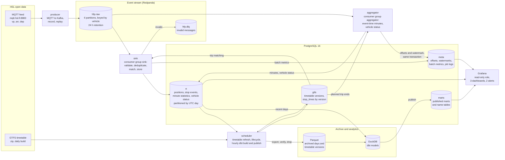

# Architecture

The platform has one source of truth for what happened, the raw topic, and one for what was planned, the timetable. Everything else is derived from those two and can be rebuilt: the stored events by consuming the topic again, the live statistics from the stored events, the archive from the database, and the marts from the archive and the database.

## Services

| Service | Runs | Reads | Writes | Restart, scaling |
|---|---|---|---|---|
| `producer` | `python -m producer.produce` | HSL MQTT (TLS, QoS 0) | `hfp.raw`, idempotent producer, key = operator/vehicle | restarted by Docker; one instance (a second would publish every message twice) |
| `sink` | `python -m processor.sink` | `hfp.raw`, timetable | `rt.vehicle_positions`, `rt.stop_events`, `hfp.dlq`, `meta.consumer_metrics` | static member `sink-1`; offsets committed after the database transaction; more instances share the partitions |
| `aggregator` | `python -m processor.aggregate` | `hfp.raw`, stored events after a restart, timetable | `rt.*_minute_stats`, `rt.vehicle_status`, `rt.late_events`, its own offsets and watermark in `meta` | static member `aggregator-1`; one instance, since a line's vehicles are spread over all partitions |
| `scheduler` | supercronic with `docker/crontab` | HSL GTFS, PostgreSQL, Parquet | timetable versions, Parquet archive, DuckDB, `marts`, `meta.archive_runs`, `meta.dbt_runs` | daily timetable refresh (03:30 UTC), daily lifecycle (00:40 UTC), hourly dbt build and publish (`:15`, skipped while the previous build runs) |
| `grafana` | Grafana 12, provisioned from `grafana/` | `rt`, `marts`, `meta` as `grafana_reader` | nothing in the platform's data | read-only sessions with a 30 s statement timeout |
| `init` | migrations, role password, first timetable | PostgreSQL, HSL GTFS | schema, timetable | runs once per `docker compose up` and exits; every step is idempotent |
| `postgres`, `redpanda` | PostgreSQL 16, Redpanda 24.2 (one node) | | | ports bound to `127.0.0.1` |

## Data paths

**Live.** A message is in `hfp.raw` a few milliseconds after HSL sends it (the producer lingers 50 ms to batch). The sink stores it within its 500 ms batch window; positions and stop events are in PostgreSQL about half a second after the vehicle reported them (p95 1.1 s). The aggregator emits each minute ten seconds after the watermark passes its end and corrects it for ten more minutes. The live dashboard reads those minutes and the vehicle status table.

**Analytical.** Every hour dbt builds the marts in DuckDB from the recent days in PostgreSQL and the archived days in Parquet, tests them, and publishes them into the `marts` schema, one table at a time in a single transaction each. The punctuality dashboard reads only those published tables.

**History.** Each table stays in PostgreSQL as long as something reads it there (positions two days, everything else seven), then is exported to Parquet, verified row for row and dropped. Timetable versions follow the same path once no event the sink can still accept could need them.

## Guarantees

| From | To | Guarantee | How |
|---|---|---|---|
| HSL | producer | at most once | MQTT QoS 0, clean session; a short disconnect loses the messages sent meanwhile |
| producer | `hfp.raw` | exactly once per message received | idempotent producer, `acks=all` |
| `hfp.raw` | `rt` tables | effectively once | at-least-once consumption, rows keyed by vehicle, event time and payload hash, offsets committed after the database transaction |
| `hfp.raw` | minute statistics | effectively once | windows keep event identities; offsets and watermark stored in the same transaction as the results; windows rebuilt from stored events after a restart |
| `rt` | Parquet | no loss | a partition is dropped only after its export is verified row for row; every step is logged and resumable |
| DuckDB | `marts` | all or nothing per table | a failed dbt build publishes nothing; each table is replaced inside one transaction |

The design notes go into each part: [producer](design_producer.md), [processing](design_processing.md), [aggregation](design_aggregation.md), [timetable](design_gtfs.md), [storage lifecycle](design_lifecycle.md), [analytics](design_analytics.md), [monitoring](design_monitoring.md) and [deployment](deployment.md).
