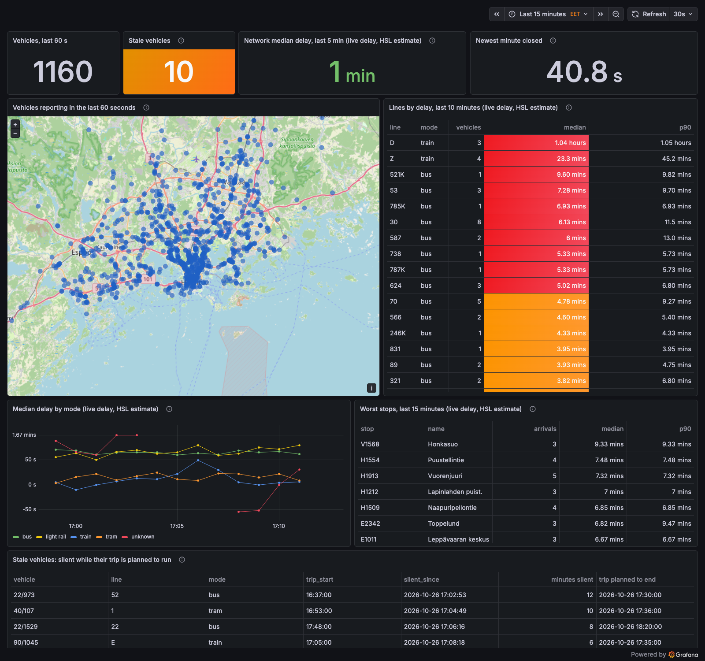
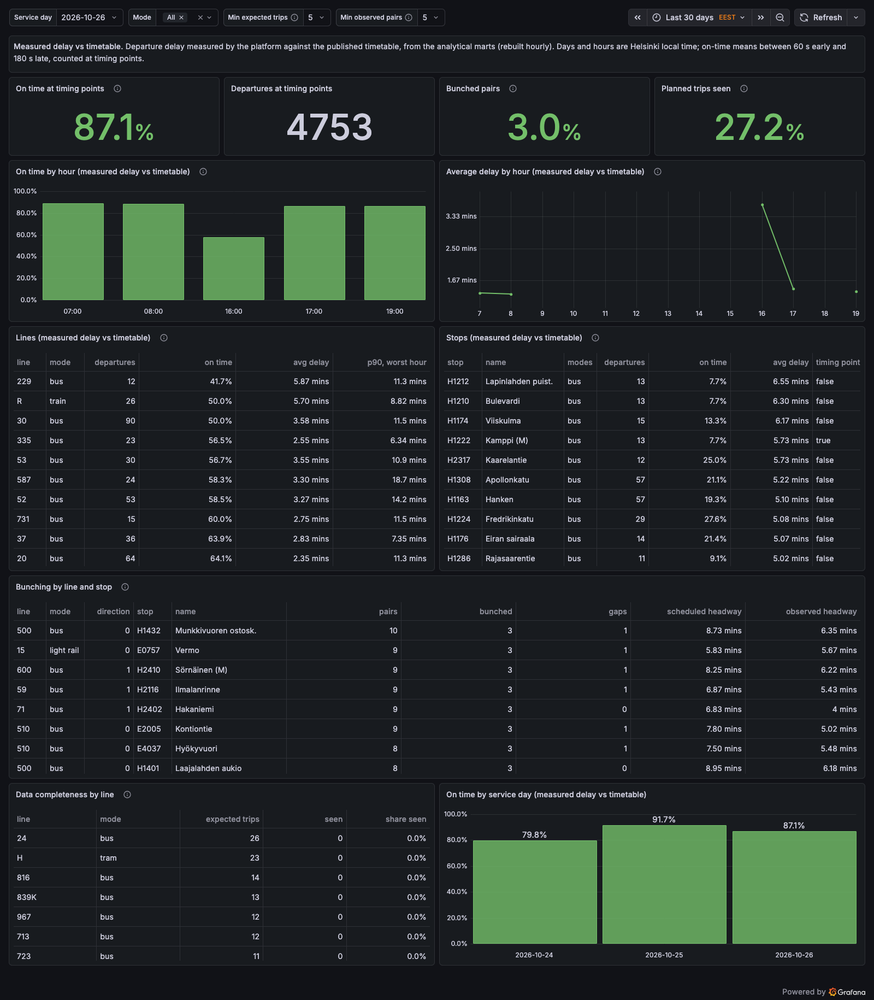
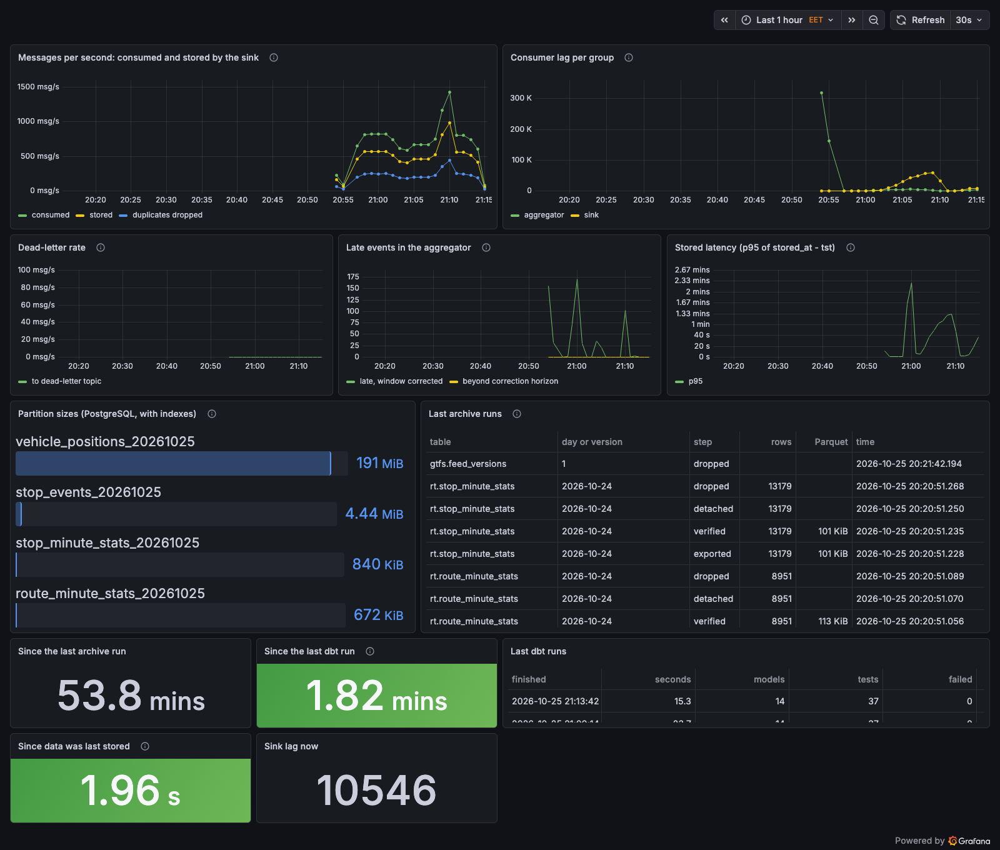

# Monitoring: design notes

Grafana shows the network as the stream sees it, punctuality as the analytical models measure it, and the health of the pipeline itself. Everything is provisioned from files in `grafana/`: the data source, three dashboards and two alert rules. A fresh `docker compose up grafana` comes up complete, with nothing to click.

## Reading only PostgreSQL, as a read-only role

Grafana has one data source: PostgreSQL, as the role `grafana_reader`. The role can read the schemas `rt` (live events and per-minute statistics), `marts` (the analytical marts, published after every dbt build) and `meta` (metrics and job logs), and nothing else:

- `SELECT` on every table in those schemas, and default privileges so that tables created later are readable too: tomorrow's partitions, created by the sink, and the marts, which are replaced by a new table on every publish.
- No access to `gtfs`. Route and stop names come from `marts.dim_routes` and `marts.dim_stops`, built from the timetable by dbt.
- Sessions are read-only (`default_transaction_read_only`) with a 30-second statement timeout, so a dashboard can neither change data nor hold the database with a runaway query.

A migration creates the role without a password; `make reader-role` sets it from `GRAFANA_READER_PASSWORD`. Roles belong to the whole PostgreSQL server, so the migration creates the role only if it does not exist yet.

A test runs every query of every dashboard, template variable and alert rule as `grafana_reader` against a database holding real messages and freshly published marts. A query that reads a table the role may not read, or that no longer matches the schema, fails the test suite instead of a dashboard.

## Dashboards

**Network now** (refreshes every 30 seconds) is the live view, built from the aggregator's tables:

- a map of every vehicle that reported in the last 60 seconds (`rt.vehicle_status`), on OpenStreetMap;
- lines and stops ordered by median delay over the last 10 and 15 minutes, with the p90 next to it, from the per-minute windows;
- median delay by mode over time; lines whose journeys matched no timetable trip have no mode and appear as *no timetable match*;
- how far the aggregator is behind the clock: the age of its watermark, green below 20 seconds, orange below a minute, red above. It is about a second when the aggregator keeps up. (The time since the newest minute window closed would be the obvious figure, but it runs from 10 to 70 seconds every minute by design and cannot carry thresholds.)
- stale vehicles: on a trip that has started and is still planned to run, and silent for two minutes. Vehicles silent before their trip's start are `waiting`, those whose trip has ended `finished`; neither is shown;
- suspect sign-ons, counted and listed: vehicles still reporting a journey that was planned to end more than 15 minutes earlier. Their delays are left out of every ranking (see [design_aggregation.md](design_aggregation.md#suspect-sign-ons)).

**Minimum sample sizes.** A ranking of a handful of events ranks noise. Every ranking therefore needs a minimum sample, chosen with a dashboard variable at the top and 5 by default: worst stops need five arriving journeys in their 15 minutes, and on *Punctuality* the completeness table ranks only lines with five expected trips and the bunching table only line and stop pairs with five observed pairs. The lines table needs no minimum of its own: a line is ranked by the middle value of up to ten per-minute medians.

All delays here are labelled **live delay, HSL estimate**: the value HSL sends in every message, which is all a live view can use. They are medians and p90s, never averages. Each minute window stores the exact median and p90 over the journeys of a line or at a stop, each journey counted once; a panel covering several minutes shows the middle value of those per-minute figures, and the network and mode figures are the median over the lines' medians. Suspect sign-ons are left out entirely. A single vehicle reporting hours of delay therefore cannot move a line, let alone the network.

**Punctuality** shows the analytical marts for one service day (chosen at the top) and the modes selected: on-time share at timing points, departures, bunching, completeness, and per line, stop and hour. On-time share by hour is drawn as bars and the average delay by hour as a line, in two panels side by side, since a share and a delay in seconds do not belong on one axis. Every percentage on the dashboards has one decimal. Its delays are labelled **measured delay vs timetable**, the platform's own measurement against the published timetable. Keeping the two labels apart matters: the live estimate and the measured delay agree closely but not exactly (see [design_analytics.md](design_analytics.md#plausibility-measured-against-live-delay)).

**Pipeline health** (every 30 seconds):

| Panel | Source |
|---|---|
| Messages per second consumed and stored, duplicates dropped | `meta.consumer_metrics`, one row per sink batch |
| Consumer lag per group | sink and aggregator batch metrics, both recording how far behind the end of the raw topic they are |
| Dead-letter rate | invalid messages per batch |
| Late events | the aggregator's corrected and dropped events |
| Stored latency | p95 of `stored_at − tst` per batch |
| Partition sizes | catalog sizes of the `rt` partitions, including the default partitions, which should stay empty |
| Last archive runs, time since the last one | `meta.archive_runs` |
| Last dbt runs, time since the last one | `meta.dbt_runs` |
| Time since data was last stored; sink lag now, in messages and in seconds of feed (the lag divided by the rate consumed over the last 15 minutes), green below 10,000 messages or 10 seconds, red from 30,000 or 30 seconds, where the lag alert's threshold lies | the latest sink batches |

"Messages in" is what the sink consumed from the raw topic. The producer's own rate is not in PostgreSQL; Grafana reads nothing else.

## Colours

A colour on a dashboard says whether a value is good or bad, so every key figure gets thresholds that match its meaning, and figures with no good or bad value (vehicles reporting, departures counted, partition sizes) stay uncoloured. Suspect sign-ons are shown in a neutral blue: their number says something about the data, not about the platform.

| Figure | Green | Orange | Red |
|---|---|---|---|
| On time at timing points | 90% or more | 80–90% | below 80% |
| Bunched pairs | below 5% | 5–10% | 10% or more |
| Planned trips seen (completeness) | 97% or more | 90–97% | below 90% |
| Stale vehicles | below 10 | 10–30 | 30 or more |
| Network median delay | below 2 min | 2–5 min | 5 min or more |
| Aggregator behind now | below 20 s | 20–60 s | 60 s or more |
| Since data was last stored | below 1 min | 1–5 min | 5 min or more (the no-data alert) |
| Sink lag now | below 10,000 messages or 10 s of feed | up to 30,000 or 30 s | above, where the lag alert's threshold lies |
| Since the last archive run (daily job) | below 26 h | 26–50 h | 50 h or more |
| Since the last dbt run (hourly job) | below 2 h | 2–4 h | 4 h or more |

## Alert rules

Two rules, provisioned from `grafana/provisioning/alerting/rules.yaml` and evaluated every minute:

| Rule | Fires when | Severity |
|---|---|---|
| Consumer lag | a consumer group's latest lag is above 30,000 messages (about 30 seconds of the feed) for five minutes | warning |
| No data for 5 minutes | the sink has not stored a single new event for more than five minutes, or has stored nothing at all in the last day | critical |

The lag rule is evaluated per consumer group, so the sink and the aggregator are separate alerts. If no batch has been committed for ten minutes, the lag rule has no data and stays quiet; the no-data rule covers that case. No notification channel is configured; the alerts show in Grafana's alerting view.

## Observed while building the dashboards

The screenshots above are from a live run on Monday evening, 26 October, between 19:40 and 20:00 Helsinki time; *Punctuality* shows that day as far as it was recorded. In the *Pipeline health* screenshot, the lag of up to 140,000 messages and the stored latency of up to four minutes between 19:40 and 19:52 were measured under host throttling (macOS limited the CPU to 20% at the time): the consumers catching up after their start. They are not performance results. The observations below come from that run and from one on Sunday evening, 25 October.

- **A slow host shows up as lag.** Between 21:02 and 21:10 Helsinki time the development laptop was overloaded (load average up to 81, CPU limited to 74%). Under host throttling, decoding a batch of 5,000 messages took 3 seconds instead of 260 ms, and the sink fell up to 59,000 messages behind; these numbers describe the laptop and are not performance results. Once the load dropped it caught up in about a minute, at 85,000 messages that minute. The bump is visible in the lag and latency panels. The lag rule went to pending at 21:06:30 and back to normal at 21:10:30: four minutes above the threshold, one short of firing.
- **One vehicle can dominate a line's average.** Commuter train line K led the list with an average of 24 minutes: one train unit stood still while still signed on to its 17:22 journey and reported 3.7 hours of delay. This is why the live panels show the median and p90 instead of the average. The measured delay in the marts is not affected (it uses departures from stops). The median has a limit, seen on Monday 26 October at 17:00 Helsinki time: commuter trains often run as two coupled units, and both units of one line Z train were signed on to the journey an hour earlier while running at full speed. They reported 85 minutes of delay and made up half of the line's vehicles in that direction, so even the median put line Z near the top. Line D above it was a single train of three coupled units on the 16:05 journey, at full speed and reporting 47 minutes of delay, the only vehicles on the line at that moment. A median protects against one wrong vehicle, not against half of a line or a whole one. Two changes followed. Delays are now taken per journey, so the coupled units of a train count once, and a vehicle reporting a journey that should have ended more than 15 minutes earlier is a suspect sign-on whose delay is left out and which is listed separately. Both trains above were caught by that rule.
- **Trips missing from the timetable.** A tram on HFP route `100HG3`, which the timetable does not contain, has no planned end, so it cannot be told apart from a vehicle that stopped mid-trip. Such vehicles were first shown as stale; they are now `unmatched` and stay out of the stale count and table.
- **Map tiles.** CARTO's tiles, Grafana's default base map, now require an API key; the map uses OpenStreetMap's tiles, with their attribution.

## Running locally

Grafana listens on `127.0.0.1` only. Anonymous visitors can view the dashboards (and nothing else), which keeps local use and the screenshots free of a login; the admin password comes from `GRAFANA_ADMIN_PASSWORD`. A deployment beyond one machine would turn anonymous access off.
