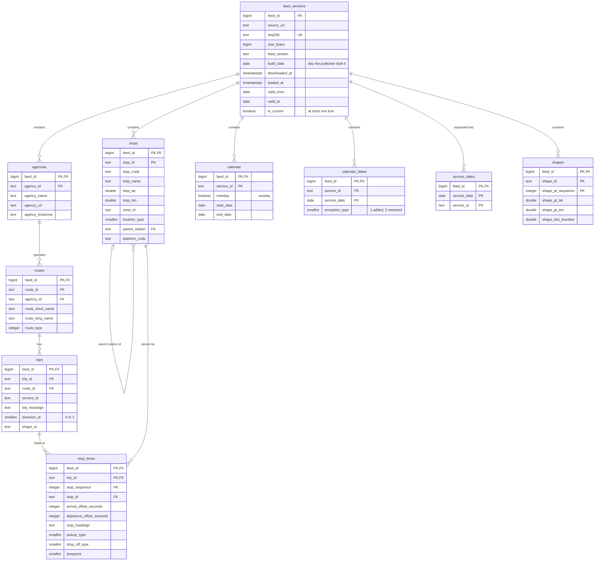

# Timetable model (schema `gtfs`)

Every table carries `feed_id`, and `feed_id` is the first column of every primary key, so any number of timetable versions can live side by side. `stop_times` is list-partitioned by `feed_id`, one partition per feed version.

`trips.service_id` has no foreign key. A service can be defined in `calendar`, in `calendar_dates`, or in both, so there is no single table to reference. `service_dates` is the place where both definitions meet. `trips.shape_id` has no foreign key either, because `shapes` has no table with one row per shape.

## Functions

| Function | Returns | Purpose |
|---|---|---|
| `gtfs.time_to_seconds(text)` | `integer` | `'25:10:00'` → `90600`; used while loading `stop_times` |
| `gtfs.service_day_start(date, time_zone)` | `timestamptz` | The instant GTFS offsets count from: local noon minus 12 hours |
| `gtfs.to_utc(date, offset_seconds, time_zone)` | `timestamptz` | Scheduled instant of a stop time on a service date |

`time_zone` defaults to `Europe/Helsinki`.
